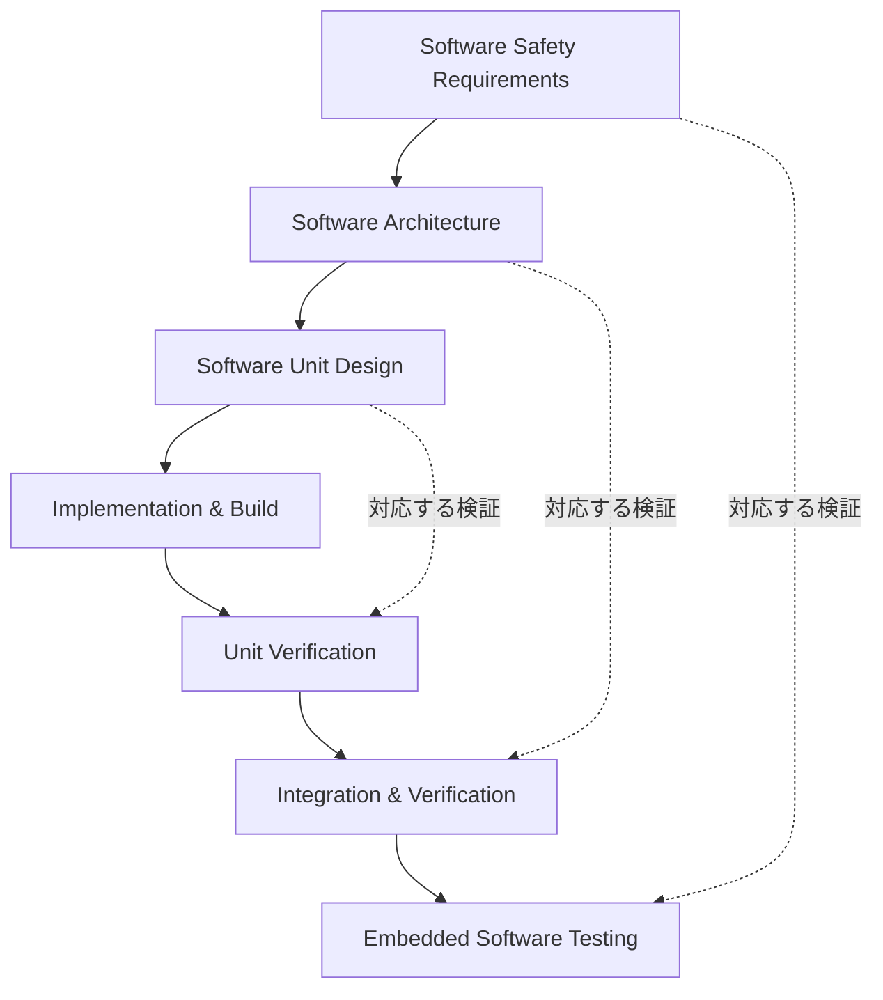
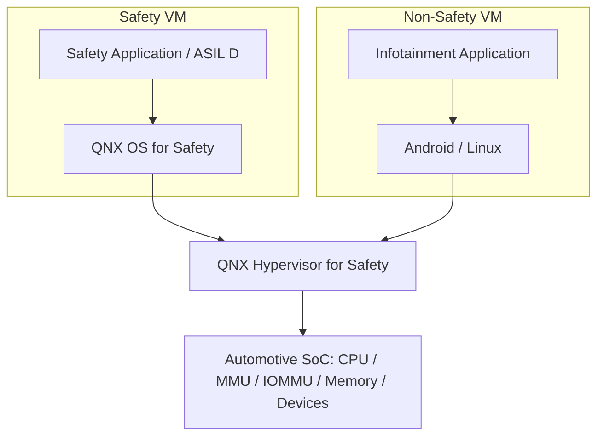
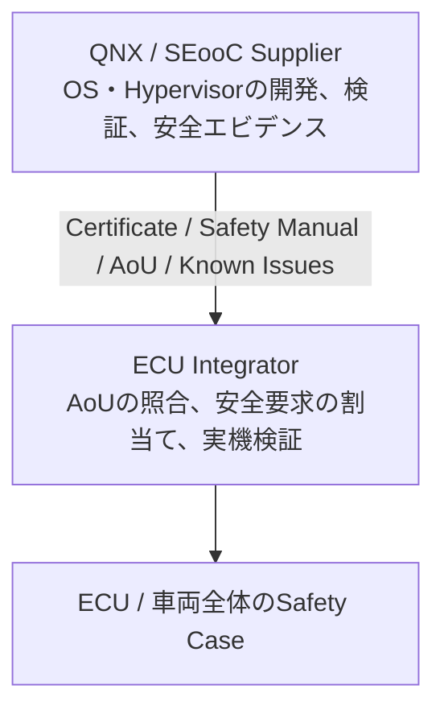

# ISO 26262 技術解説：Part 6・QNX Hypervisor・SEooC

> 対象：車載ECUのソフトウェアアーキテクト／OS開発者  
> 基準：ISO 26262:2018、QNX OS for Safety / QNX Hypervisor for Safety の一般的な考え方  
> 注意：具体的な認証範囲・安全上の前提条件は、対象製品バージョンの認証資料とSafety Manualで確認してください。以下の要求ID、時間予算、AoUは説明用の例です。

## 目次

1. [ISO 26262の概要](#1-iso-26262の概要)
2. [ISO 26262 Part 6：C/C++ソフトウェア開発](#2-iso-26262-part-6ccソフトウェア開発)
3. [QNX HypervisorとFreedom from Interference（FFI）](#3-qnx-hypervisorとfreedom-from-interferenceffi)
4. [SEooCとQNX OS for Safety](#4-seoocとqnx-os-for-safety)
5. [3テーマの統合：仮想ECUの例](#5-3テーマの統合仮想ecuの例)
6. [実践的な検証テーマ](#6-実践的な検証テーマ)
7. [学習の優先順位と参考資料](#7-学習の優先順位と参考資料)

---

## 1. ISO 26262の概要

**ISO 26262**は、自動車の電気・電子（E/E）システムに関する**機能安全（Functional Safety）**の国際規格です。故障に起因する危険を特定し、そのリスクを許容可能な水準まで低減するためのライフサイクルと開発活動を定めています。

例えば電動パワーステアリング（EPS）の制御ソフトウェアが異常な操舵アシストを指令すると、事故につながるおそれがあります。ISO 26262では危険分析、要求定義、設計、検証、妥当性確認、安全性の論証を体系的に行います。

### 1.1 ASIL

ASIL（Automotive Safety Integrity Level）は、安全要求に適用する厳格さの水準で、AからDまであり、Dが最も厳格です。QMはASILが割り当てられない通常の品質管理対象です。

| 区分 | 概要 |
|---|---|
| ASIL D | 最も厳格な安全要求 |
| ASIL C | 高度な安全要求 |
| ASIL B | 中程度の安全要求 |
| ASIL A | ASILの中で最も低い水準 |
| QM | ISO 26262のASIL固有要求を割り当てない領域 |

HARA（Hazard Analysis and Risk Assessment）で扱う主な評価要素は次のとおりです。

| 要素 | 意味 |
|---|---|
| Severity（S） | 危害の重大度 |
| Exposure（E） | 危険な運転状況への曝露確率 |
| Controllability（C） | ドライバーなどによる危険回避の可能性 |

ASILは単純な故障確率の大小だけで決まるものではありません。

### 1.2 ISO 26262:2018の構成

| Part | 内容 |
|---|---|
| 1 | 用語 |
| 2 | 機能安全マネジメント |
| 3 | コンセプトフェーズ・HARA |
| 4 | システムレベル開発 |
| 5 | ハードウェアレベル開発 |
| **6** | **ソフトウェアレベル開発** |
| 7 | 生産・運用・サービス・廃棄 |
| 8 | 支援プロセス |
| 9 | ASILに関する分析 |
| 10 | ガイドライン |
| 11 | 半導体への適用 |
| 12 | モーターサイクルへの適用 |

---

## 2. ISO 26262 Part 6：C/C++ソフトウェア開発

### 2.1 Part 6の目的

Part 6は、ソフトウェア安全要求を、アーキテクチャ設計、ユニット設計・実装、ユニット検証、統合・検証、組込みソフトウェアテストへと展開するための枠組みです。

重要なのは、**動作テストに成功したことだけではなく、安全要求を満たすことを客観的な証拠で説明できること**です。

### 2.2 V字モデルとトレーサビリティ



上流の安全要求、詳細設計、ソースコード、テスト結果の対応関係を追跡できることが必要です。

**EPSの例（架空）：**

| ID | 内容 |
|---|---|
| SG-001 | 意図しない操舵アシストによる危険を防止する |
| TSR-001 | トルク指令の異常を検出して危険な出力を抑制する |
| SSR-001 | トルク指令を周期的に検査する |
| SWU-001 | `TorqueMonitor`が指令値の範囲を検査する |
| TST-001 | 異常値入力時に安全側の出力となることを確認する |

SG = Safety Goal、TSR = Technical Safety Requirement、SSR = Software Safety Requirement。

### 2.3 C/C++設計・実装で重要な点

| 技術項目 | 安全上の関心 |
|---|---|
| 動的メモリ確保 | メモリ不足、実行時間の予測不能性 |
| ポインタ操作 | 不正アクセス、メモリ破壊 |
| スレッド・排他制御 | デッドロック、競合、優先順位逆転 |
| エラー処理 | 故障が検出・処理されない |
| 割込み・タイミング | 期限超過 |
| 未定義動作 | 実行結果を予測できない |
| コンパイラ最適化 | 実装意図との不一致 |

MISRA C/C++、静的解析、コードレビュー、動的解析などを利用します。ただし、ISO 26262はC++の特定機能や動的メモリ確保を一律に禁止する規格ではありません。安全要求と設計根拠に基づく選択が必要です。

### 2.4 C++の実装例

```cpp
#include <cstdint>

enum class Status : std::uint8_t {
    Ok,
    InvalidInput,
    OverLimit
};

struct TorqueResult {
    Status status;
    std::int32_t safe_command;
};

TorqueResult checkTorque(
    std::int32_t command,
    std::int32_t max_abs)
{
    if (max_abs <= 0) {
        return {Status::InvalidInput, 0};
    }

    if (command > max_abs || command < -max_abs) {
        return {Status::OverLimit, 0};
    }

    return {Status::Ok, command};
}
```

異常入力に対してゼロ指令を返すだけでは安全性は成立しません。少なくとも以下を分析します。

- `max_abs`は誰が保証し、どう設定するか
- 指令値の大きさだけでなく、時系列で不自然な値をどう検出するか
- ゼロ指令は対象車両で本当に安全状態なのか
- センサー・通信異常への対応
- 故障検出から出力反映までの時間
- 共通原因故障により監視機構自身が失われないか

### 2.5 FTTI（Fault Tolerant Time Interval）

故障が危険に至る前に安全機構が対処すべき時間的制約を考えます。例えば架空のFTTIが100msであれば、次のように時間予算を配分できます。

| 活動 | 例の時間 |
|---|---:|
| 故障検出 | 20ms |
| ソフトウェア応答 | 30ms |
| アクチュエータ応答 | 30ms |
| 余裕 | 20ms |
| **合計** | **100ms** |

数値は説明用です。OSスケジューリング、割込み遅延、優先順位逆転、CPU負荷を考慮し、安全動作が期限内に終わることを示す必要があります。

### 2.6 テストと検証

- 要求ベースのテスト
- 境界値解析、異常入力テスト
- Statement／Branch／MC/DCなどの構造カバレッジ分析
- 静的解析、コードレビュー
- WCET（Worst-Case Execution Time）などの時間解析
- Fault Injection Test
- ソフトウェア統合テスト

**コードカバレッジ100%だけでは、安全要求を満たしたことにはなりません。** 検証の十分性と、安全要求そのものの妥当性は別に評価します。

---

## 3. QNX HypervisorとFreedom from Interference（FFI）

### 3.1 なぜFFIが必要か

1つのSoC上に以下を同居させる例を考えます。

- Safety VM：ADAS制御（ASIL D）
- Non-Safety VM：Android Infotainment（QM）

Androidが異常なCPU負荷をかけても、ADASの安全動作を妨害してはいけません。

FFIの観点としては次が代表的です。

| 分類 | 例 |
|---|---|
| Spatial interference | AndroidがSafety VMのメモリを破壊する |
| Temporal interference | Androidの負荷で安全タスクが期限を超える |
| Communication interference | 不正・欠落・遅延した通信データが安全機能へ影響する |

これらは技術的な分析に役立つ分類であり、実際の干渉分析では共有デバイス、DMA、キャッシュ、割込みなども扱います。

### 3.2 仮想化構成



これは概念図です。ゲストOS、仮想デバイス、BSP、SoCの組み合わせが認証範囲に含まれるかは、製品の資料で確認します。

### 3.3 Spatial Isolation（空間的分離）

代表的な機構：

- MMUによるCPUアクセスのメモリ保護
- HypervisorによるVM間メモリ領域の分離
- IOMMU/SMMUによるDMAのアクセス制御
- デバイス割当て、アクセス権限管理

**MMUだけではDMAからの不正書き込みまで保証できません。** デバイス所有権、IOMMU設定、共有DMAバッファを確認する必要があります。

### 3.4 Temporal Isolation（時間的分離）

Safety VMとAndroid VMに別々のCPUコアを割り当てても、共有キャッシュ、メモリ帯域、割込みコントローラ、熱・電力制御などにより実行時間が影響を受ける可能性があります。

検討対象はCPU割当て、スケジューリングポリシー、割込み負荷、共有メモリ帯域、最悪実行時間などです。通常負荷だけでなく、Non-Safety VMの異常高負荷時にも時間制約を満たせることが重要です。

### 3.5 Communication Interference（通信干渉）

Safety VMがAndroid VMから情報を受信するとき、受信データを無条件には信用できません。

| 故障モード | 対策例 |
|---|---|
| データ破損 | CRC、整合性検査 |
| 欠落・重複 | Sequence Counter |
| 古いデータ | Timestamp、Timeout |
| 不正な値 | Range Check |
| 送信元の異常 | 健全性監視、必要に応じた認証 |

End-to-End Protectionを使用しても、**正常なCRCが付いた誤った計算結果**まで保証されるわけではありません。受信側の妥当性検査が必要です。

### 3.6 QNX HypervisorのFFIチェック観点

| 技術領域 | 確認事項 |
|---|---|
| VMメモリ | VMごとの範囲が適切に分離されるか |
| CPU | Safety VMの時間要件を満たすか |
| 割込み | IRQ配送と遅延が適切か |
| DMA | IOMMU設定とアクセス権限は適切か |
| 仮想デバイス | 安全認証の対象範囲に含まれるか |
| Hostサービス | Host故障がGuestへ波及しないか |
| 通信経路 | データ破損・遅延に対応できるか |
| 障害処理 | VM停止・再起動時に安全動作できるか |

**Hypervisor導入だけではFFIは成立しません。** SoC、Hypervisor、ドライバ、VM構成、共有資源を含めて論証します。

---

## 4. SEooCとQNX OS for Safety

### 4.1 SEooCとは

SEooC（Safety Element out of Context）は、最終的な車両・ECUの使用状況が確定する前に、所定の安全上の前提条件の下で開発されたコンポーネントです。

OS開発者がすべての車種、ECU、SoC、Safety Goal、FTTIを事前に確定することはできません。そのため、仮定した条件の下でOSを開発・評価し、Integratorにその前提条件を引き渡します。

### 4.2 責任分界



**認証済みのASIL D対応SEooCを使うことと、ECU全体のASIL Dを実現することは同義ではありません。**

### 4.3 Assumptions of Use（AoU）

AoUは、SEooCの安全性の前提として、利用者が満たす必要のある条件です。

以下は**架空の例であり、QNX実際のSafety Manualの内容ではありません**。

| 仮想AoU | Integrator側の対応例 |
|---|---|
| AOU-01：指定されたCPU/BSP構成を使う | SoC・BSP・OSの組み合わせを照合 |
| AOU-02：安全関連エラーを監視する | 故障監視機構を実装 |
| AOU-03：時間制約を満たす | 最悪時の時間解析を行う |
| AOU-04：メモリ分離を維持する | MMU/IOMMU設定を検証 |
| AOU-05：定められた復旧動作を行う | 異常時の状態遷移を検証 |

### 4.4 Safety Manualで確認すること

- 認証されたコンポーネントとバージョン
- 使用可能な構成、制約
- Assumptions of Use
- 安全関連API、利用上の制限
- 故障通知と異常処理
- Integrator側で実装すべき対策
- Known Issues、必要な修正
- Safety Caseに利用できるエビデンス

Safety Manualは単なる操作マニュアルではなく、**安全なシステムへ統合するための条件を定める文書**です。

### 4.5 ECU統合の基本手順

1. **安全要求の確定**：HARA、Safety Goal、Functional / Technical Safety Conceptを整理する。
2. **QNX認証範囲の確認**：製品、バージョン、BSP、ツールチェーン、構成を照合する。
3. **AoUレビュー**：各前提条件を満たしているか評価する。
4. **Gap Analysis**：QNX側の評価範囲とECUの要求の差を特定する。
5. **統合検証**：タイミング、故障処理、メモリ保護、VM分離、通信、再起動を実機確認する。
6. **Safety Case作成**：SEooCエビデンス、自社実装の検証結果、残留リスクを関連付ける。

**Gap Analysisの例：**

| 項目 | 状況 | 次の作業 |
|---|---|---|
| Safety対応OS使用 | 充足 | バージョン固定 |
| 対象SoCサポート | 要確認 | 認証範囲の照合 |
| FTTI達成 | 未検証 | 最悪時間解析 |
| VM間メモリ分離 | 設計済み | DMAを含む故障注入 |
| Watchdog復旧 | 部分実装 | 故障時動作検証 |
| Known Issuesの評価 | 未完了 | 影響分析・対策 |

---

## 5. 3テーマの統合：仮想ECUの例

1つのSoC上に「Safety Application + QNX OS for Safety」と「Android Infotainment」を動かすケースを考えます。

| 領域 | 主な対応 |
|---|---|
| Part 6 | 安全要求からC/C++実装・検証への追跡 |
| FFI | Hypervisorを含むVM間の空間・時間・通信干渉対策 |
| SEooC | QNX安全エビデンスとAoUを引き継ぐ |
| ECU全体 | HARAからSafety Caseまでの整合性を論証 |

重要な問いは、**「OS・Hypervisorがどの範囲を保証し、アプリケーション／ECU側がどこから証明するのか？」**です。

---

## 6. 実践的な検証テーマ

QNX HypervisorのQEMU環境は、FFIの仕組みの学習に利用できます。

| 実験 | 主な目的 |
|---|---|
| VM1からVM2へのメモリアクセスを試みる | 空間的分離 |
| GuestにCPU高負荷をかける | 時間的干渉 |
| Guestを強制終了する | 障害の封じ込め |
| VM間通信を遮断する | Timeoutと安全動作 |
| Guestを再起動する | 復旧時の状態遷移 |
| 共有デバイスに高負荷をかける | 共有資源の干渉 |

QEMUでの検証は学習・機能確認に有効ですが、**実SoCでのDMA分離やワーストケース実行時間の証明には代わりません**。

### 6.1 認証レベルとツールの区別

- **ASIL D**：安全要求に対するIntegrity Level
- **TCL3**：ソフトウェアツール信頼度分類（Tool Confidence Level）

この2つは意味が異なります。また、製品全体の認証レベルと、個別のコンポーネント・ファイルシステム・仮想デバイスが対象に含まれるかも区別します。具体的なツール適格性確認範囲は製品資料で照合してください。

---

## 7. 学習の優先順位と参考資料

| 優先度 | テーマ | 理解の目標 |
|---|---|---|
| 1 | SEooCとSafety Manual | QNXの保証範囲とIntegratorの責務 |
| 2 | FFI | Hypervisorによる障害伝播防止 |
| 3 | Part 6 | 安全要求から実装・検証までの追跡 |
| 4 | Timing Analysis | リアルタイム性の論証 |
| 5 | Safety Case | 安全性を示す証拠の構成 |

### 参考資料

- [ISO 26262-6:2018 — Product development at the software level](https://www.iso.org/standard/68388.html)
- [QNX OS / OS for Safety](https://qnx.software/en/software/products-and-solutions/qnx-os-and-os-for-safety)
- [QNX Hypervisor / Hypervisor for Safety](https://qnx.software/en/software/products-and-solutions/qnx-hypervisor-and-hypervisor-for-safety)
- [QNX Certifications and Compliance](https://qnx.software/ja/developers/developer-roadmap/certifications-and-compliance)

> **結論：** ASIL D対応のQNX OSやHypervisorは、安全システム構築のための重要な基盤です。しかし、それを使用するだけでECUのASIL Dが保証されるわけではありません。Part 6に沿ったソフトウェア開発、FFIのシステムレベルの論証、SEooCのAoU遵守、統合検証を結び付けることが必要です。
