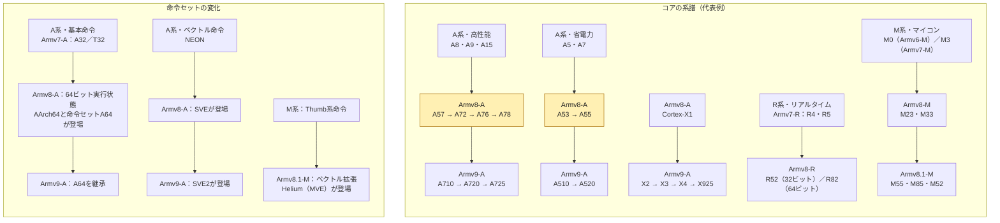

# QNX、Arm、車載SoCの話

QNX SDP 8.0のBSP一覧を起点に、昔の組み込みCPU、Armの系譜、車載SoCの機能までたどった会話です。各章では、チャットの質問と回答を当時の順序で掲載しています。

- **QNXとBSP** — 6.5 SP1ではMIPS・PowerPC・SH-4にも対応。8.0.5の公式ターゲットはAArch64とx86-64。BSPの確認にはSoC型番、ボード、QNXのバージョンが必要です。
- **Armの系譜** — ARM7TDMIのThumbから、CortexのA・R・Mへ。A53とA76はArmv8-Aの異なるコアで、QualcommのOryonやApple M5のCPUコアもAArch64を使います。
- **車載SoC** — 上位処理は中央へ集約し、短周期の制御は現場のマイコンや専用リアルタイムコアが担います。ADASでは物体検出・追跡が経路計画や車両制御につながります。

QNXの公開BSP表、Armの技術資料、各メーカーの仕様へのリンクは、該当する回答に残しています。添付された系譜図に続いて作成した図は、Mermaid対応のMarkdownビューアで表示できます。

## QNXのBSPと車載SoC

### 1. QNX OSが対応しているBSPのうち、主なものを

**QNX OS 8.0（QNX SDP 8.0）**の公式資料に掲載されている主なBSP（Board Support Package）は以下のとおりです。

| メーカー・系統 | 代表的な対応ボード | 公式資料 |
|---|---|---|
| Broadcom / Raspberry Pi | Raspberry Pi 4 Model B（BCM2711）、Raspberry Pi 5（BCM2712） | [Broadcom](https://www.qnx.com/developers/docs/BSP8.0/com.qnx.doc.bsp.nav/topic/vendor.broadcom.html) |
| NXP | i.MX 8M Plus EVK、i.MX 8 QuadMax MEK、i.MX93 EVK、i.MX95 EVK、S32G-VNP-RDB3 | [NXP](https://www.qnx.com/developers/docs/BSP8.0/com.qnx.doc.bsp.nav/topic/vendor.nxp.html) |
| Texas Instruments | Jacinto 7 J721E EVM、TDA4VM Starter Kit | [Texas Instruments](https://www.qnx.com/developers/docs/BSP8.0/com.qnx.doc.bsp.nav/topic/vendor.texasinstruments.html)、[TDA4VM Starter Kit](https://get.qnx.com/developers/docs/relnotes8.0/com.qnx.doc.release_notes/topic/sdp8_rn.html) |
| Intel / x86-64 | Generic x86-64 BSP。対応機種の例はAdvantech MIO-5375C5、Dell Precision 3660、Kontron 3.5″-SBC-TGL | [Intel系ボード](https://www.qnx.com/developers/docs/BSP8.0/com.qnx.doc.bsp.nav/topic/vendor.intel.html) |
| AMD / Xilinx | Versal AI Edge VE2302評価ボード、Kria KV260・KR260、Ryzen Sapphire Edge（V2000） | [AMD](https://www.qnx.com/developers/docs/BSP8.0/com.qnx.doc.bsp.nav/topic/vendor.amd.html) |
| Renesas | R-Car X5H（Ironhide） | [Renesas](https://www.qnx.com/developers/docs/BSP8.0/com.qnx.doc.bsp.nav/topic/vendor.renesas.html) |

対応はQNX SDPのバージョンとボードの型番に依存します。画面出力やWi-Fiなどが必要な場合は、各BSPのリリースノートで対応機能を確認できます。[QNX SDP 8.0 BSP公式資料](https://www.qnx.com/developers/docs/BSP8.0/com.qnx.doc.bsp.nav/topic/about.html)

### 2. このうち、車載SoCはどれですか

前の一覧で、**車載向けとして明確に位置づけられているSoC**は、NXPの **S32G399A**、TIの **TDA4VM-Q1／DRA829V-Q1**、Renesasの **R-Car X5H** です。

| 車載SoC | 主な用途 | 前の一覧にあるQNX BSP対象ボード |
|---|---|---|
| **NXP S32G399A** | 車載ネットワーク、セントラルゲートウェイ | S32G-VNP-RDB3。[NXP](https://www.nxp.com/products/S32G3) |
| **TI Jacinto 7 TDA4VM-Q1／DRA829V-Q1** | TDA4VMはADAS、DRA829Vは車載ゲートウェイ | J721E EVM、TDA4VM Starter Kit。[TI](https://www.ti.com/about-ti/newsroom/news-releases/2020/2020-01-07-new-low-power--high-performance-ti-jacinto--7-processors-enable-mass-market-adoption-of-automotive-adas-and-gateway-technology.html) |
| **Renesas R-Car X5H** | ADASやコックピットなど、複数の機能を統合する車載コンピューター | R-Car X5H（Ironhide）。[Renesas](https://www.renesas.com/en/about/newsroom/renesas-unveils-industry-s-first-automotive-multi-domain-soc-built-3-nm-process-technology) |

**車載用途にも展開されている汎用SoC**まで含めると、NXPの **i.MX 8 QuadMax、i.MX 93、i.MX 95** も該当します。AMDの **Versal AI Edge VE2302** にも、車載グレードの **XAVE2302** があります。量産向けに選ぶ場合は、採用するSoCの部品型番とQNX BSPの対象ボードをそれぞれ確認してください。[NXP i.MX 8 QuadMax](https://www.nxp.com/products/i.MX8)、[NXP i.MX 93 車載品データシート](https://www.nxp.com/docs/en/data-sheet/IMX93AEC.pdf)、[NXP i.MX 95](https://www.nxp.com/products/i.MX95)、[AMD Versal車載グレード](https://docs.amd.com/r/en-US/ds958-versal-ai-edge/Revision-History)

### 3. ちなみに、主なものだけでなく、一覧だとどうなりますか

直前の話題に合わせて、**QNX SDP 8.0の公開BSP資料で確認できる車載SoCと、そのBSP対象ボード**を一覧にしました。前の回答で挙げたものに加え、TIのJacinto 7評価ボードを4種類追加しています。[QNX SDP 8.0 BSP公式資料](https://www.qnx.com/developers/docs/BSP8.0/com.qnx.doc.bsp.nav/topic/about.html)

| メーカー | 車載SoC・製品系列 | QNX BSP対象ボード |
|---|---|---|
| NXP | **S32G399A** | S32G-VNP-RDB3。[QNX](https://www.qnx.com/developers/docs/BSP8.0/com.qnx.doc.bsp.nav/topic/vendor.nxp.html)、[NXP](https://www.nxp.com/products/S32G3) |
| NXP | **i.MX 8 QuadMax** | i.MX 8 QuadMax MEK、Toradex Apalis i.MX8QM Ixora。[QNX](https://www.qnx.com/developers/docs/BSP8.0/com.qnx.doc.bsp.nav/topic/vendor.nxp.html)、[車載品データシート](https://www.nxp.com/docs/en/data-sheet/IMX8QM1P3AEC.pdf) |
| NXP | **i.MX 93** | i.MX93 EVK、Phytec phyBOARD-NASH-i.MX93 + NASH carrier。[QNX](https://www.qnx.com/developers/docs/BSP8.0/com.qnx.doc.bsp.nav/topic/vendor.nxp.html)、[車載品データシート](https://www.nxp.com/docs/en/data-sheet/IMX93AEC.pdf) |
| NXP | **i.MX 95** | i.MX95 EVK、Variscite i.MX95 DART Board。[QNX](https://www.qnx.com/developers/docs/BSP8.0/com.qnx.doc.bsp.nav/topic/vendor.nxp.html)、[NXP](https://www.nxp.com/products/i.MX95) |
| TI | **Jacinto 7 J721E**（TDA4VM、DRA829系） | J721E EVM、TDA4VM Starter Kit。[QNX](https://www.qnx.com/developers/docs/BSP8.0/com.qnx.doc.bsp.nav/topic/vendor.texasinstruments.html)、[TI](https://www.ti.com/tool/J721EXSOMXEVM) |
| TI | **Jacinto 7 J721S2**（TDA4VE、TDA4VL、TDA4AL系） | J721S2 EVM。[QNX](https://www.qnx.com/developers/docs/BSP8.0/com.qnx.doc.bsp.nav/topic/vendor.texasinstruments.html)、[TI](https://www.ti.com/lit/an/sprad91b/sprad91b.pdf) |
| TI | **Jacinto 7 J722S**（TDA4VEN、TDA4AEN系） | J722S EVM。[QNX](https://www.qnx.com/developers/docs/BSP8.0/com.qnx.doc.bsp.nav/topic/vendor.texasinstruments.html)、[TI](https://www.ti.com/lit/an/sprad91b/sprad91b.pdf) |
| TI | **Jacinto 7 J742S2**（TDA4VPE、TDA4APE系） | J742S2 EVM。[QNX](https://www.qnx.com/developers/docs/BSP8.0/com.qnx.doc.bsp.nav/topic/vendor.texasinstruments.html)、[TI](https://www.ti.com/lit/an/sprad91b/sprad91b.pdf) |
| TI | **Jacinto 7 J784S4**（TDA4VH、TDA4AH、TDA4VP、TDA4AP系） | J784S4 EVM。[QNX](https://www.qnx.com/developers/docs/BSP8.0/com.qnx.doc.bsp.nav/topic/vendor.texasinstruments.html)、[TI](https://www.ti.com/lit/an/sprad91b/sprad91b.pdf) |
| Renesas | **R-Car X5H** | R-Car X5H（Ironhide）。[QNX](https://www.qnx.com/developers/docs/BSP8.0/com.qnx.doc.bsp.nav/topic/vendor.renesas.html)、[Renesas](https://www.renesas.com/en/about/newsroom/renesas-unveils-industry-s-first-automotive-multi-domain-soc-built-3-nm-process-technology) |

**車載品番と評価ボードの組み合わせを個別に確認したい例**は、AMDの **Versal AI Edge XAVE2302** とTIの **AM62P-Q1** です。メーカーは車載品番を公開しており、QNXの公開一覧にはそれぞれ **VE2302評価ボード** と **AM62P Starter Kit EVM** が掲載されています。上表のボードについても、量産で使う部品型番とBSPの対応範囲は、各BSPのリリースノートで確認できます。[AMD車載品番](https://docs.amd.com/r/en-US/ds958-versal-ai-edge/Revision-History)、[QNXのAMDボード一覧](https://www.qnx.com/developers/docs/BSP8.0/com.qnx.doc.bsp.nav/topic/vendor.amd.html)、[TI AM62P-Q1](https://www.ti.com/product/AM62P-Q1)、[QNXのTIボード一覧](https://www.qnx.com/developers/docs/BSP8.0/com.qnx.doc.bsp.nav/topic/vendor.texasinstruments.html)

### 4. どれもaarch64leですか

はい。**直前の車載SoC一覧は、QNX OS 8.0のターゲットとしてはすべて `aarch64le`**（64ビットArm、リトルエンディアン）です。補足に挙げたAMD Versal AI Edge VE2302評価ボードとTI AM62P Starter Kit EVMも同じです。[QNXのターゲット表記](https://www.qnx.com/developers/docs/8.0/com.qnx.doc.neutrino.building/topic/buildfiles/nto_bootstrap.html)、[QNX BSP公式資料](https://www.qnx.com/developers/docs/BSP8.0/com.qnx.doc.bsp.nav/topic/about.html)

最初のBSP一覧まで含めると、**Intel Generic x86-64とAMD Ryzen Sapphire Edgeは `x86_64`** です。[IntelのBSP一覧](https://www.qnx.com/developers/docs/BSP8.0/com.qnx.doc.bsp.nav/topic/vendor.intel.html)、[AMDのBSP一覧](https://www.qnx.com/developers/docs/BSP8.0/com.qnx.doc.bsp.nav/topic/vendor.amd.html)

### 5. Xilinx　ってAMD ?

はい。AMDは2022年2月にXilinx（ザイリンクス）を買収しました。QNXのBSP一覧で **Xilinx Versal** や **Xilinx Zynq** が **AMD** のページに載っているのはそのためです。[AMDの買収発表](https://ir.amd.com/news-events/press-releases/detail/1047/amd-completes-acquisition-of-xilinx)、[QNXのAMDボード一覧](https://www.qnx.com/developers/docs/BSP8.0/com.qnx.doc.bsp.nav/topic/vendor.amd.html)

### 6. Qualcomm のSC とかは、どう考えたらいいですか

Qualcommは前の車載SoC一覧に補足すべきです。**車載QNXの候補としては、SC系より、まずSA系の具体的な型番を見ます。**

- **SC系の例：SC8280XP** は、ノートPC向けの **Snapdragon 8cx Gen 3 Compute Platform** です。Arm64であることと、そのボード向けのQNX BSPが提供されていることは別々に確認します。[Qualcommの型番対応表](https://www.qualcomm.com/company/product-security/bulletins/february-2024-bulletin)、[8cx Gen 3製品ページ](https://www.qualcomm.com/laptops/products/snapdragon-8cx-gen-3-compute-platform)
- **SA系の例：SA8155P、SA8295P、SA8255P** は車載側の候補です。QualcommはSA8155Pの製品資料でQNX対応を明記しています。また、SA8295とSA8255は、QualcommのAI SDKで `aarch64-qnx` の対象に挙がっています。[SA8155P製品資料](https://www.qualcomm.com/content/dam/qcomm-martech/dm-assets/documents/qul7413_sa8155_productbrief_r4.pdf)、[Qualcomm AI SDKの対応表](https://docs.qualcomm.com/nav/home/QNN_general_overview.html?product=924033590759186372)

今回の **QNX SDP 8.0 BSP一覧**に載せるには、SoC型番に加えて、**対象ボードと対応するQNXバージョン**まで確認が必要です。Qualcommの `aarch64-qnx` 表記から確認できるのは、そのAI SDKのArm64向けQNXツールチェーン対応までです。上記SA系について、SDP 8.0用BSPの提供範囲は公開資料から確認できていません。[QNXの公開BSP一覧](https://www.qnx.com/developers/docs/BSP8.0/com.qnx.doc.bsp.nav/topic/about.html)

## Freescale、KZM、CortexとThumb

### 7. iMX ってNXPでしたっけ？ARM9 のころに触った記憶が

はい、**今はNXPのi.MXですが、ARM9の頃はFreescaleのi.MX**です。NXPとFreescaleは2015年12月に合併しました。[NXPの合併発表](https://www.nxp.com/company/about-nxp/newsroom/NW-NXP-FREESCALE-MERGE)

当時触ったものなら、**i.MX21やi.MX27** が候補です。たとえばi.MX27は **ARM926EJ-S** を搭載していて、当時の製品資料にもFreescaleの名前が載っています。[Freescaleのi.MX27製品資料](https://www.nxp.com/docs/en/fact-sheet/TRINITYCONCOFS.pdf)

### 8. FreeScale 懐かしい！

「Freescaleのi.MX」と聞くと、ARM9の頃の記憶とつながりますね。いまのQNX BSP一覧にあるNXPのi.MX 8やi.MX 9も、そのi.MXの後継世代です。

### 9. KZM ってボードありませんでしたか？

ありました。京都マイクロコンピュータが2006年に発表した **KZM-ARM11-01** です。Freescaleの **i.MX31（ARM1136、532 MHz）** を載せた評価ボードで、Linux 2.6が付属していました。[京都マイクロコンピュータの当時の発表](https://www.kmckk.co.jp/news3/r0606212.html)

「Freescaleのi.MXでKZM」という記憶なら、このボードが有力です。CPUは、先ほどのi.MX27のARM9に続く **ARM11世代** ですね。

### 10. あーやっぱり！

KZMという名前、合ってましたね。2006年の発表資料がまだ読めるのもいいですね。

### 11. ARM7T DMI

**ARM7TDMI**（アームセブン・ティーディーエムアイ）ですね。`T` はThumb命令、`D` はデバッグ、`M` は高速乗算器、`I` はEmbeddedICEを指します。

世代順に並べると、**ARM7TDMI → ARM9（i.MX27のARM926EJ-S）→ ARM11（KZM-ARM11-01のARM1136）** です。

### 12. Cortex-M のルーツは？

**Cortex-Mの出発点は、マイコン向けのCortex-M3（Armv7-M）**です。名前の **M** は *Microcontroller* を指します。ARM7TDMIとのつながりをたどるなら、命令セットの **Thumb** が分かりやすいです。[Armのアーキテクチャ解説](https://documentation-service.arm.com/static/684be32a3f793d5d7b223563?token=)

- **ARM7TDMI（Armv4T）** は、32ビットのARM命令と、コードを小さくする16ビットのThumb命令を切り替えて使えました。
- **Cortex-M3（Armv7-M）** は、16ビット命令と32ビット命令を混在できる**Thumb-2**を採用し、割り込みコントローラ（NVIC）もコアに統合しました。[Armの命令セット解説](https://documentation-service.arm.com/static/6893ad23e7f7ce6150e88d37)

ちなみに、**Cortex-M0はM3より後**です。M3が先に登場し、その後、より小規模なマイコン向けにM0（Armv6-M）が加わりました。

### 13. THUMBって何でしたっけ、小さい命令ご？

はい、**命令のサイズが小さい**という意味なら、その通りです。ARM7TDMIでは、通常のARM命令は1命令 **32ビット（4バイト）**、初代Thumb命令は **16ビット（2バイト）** でした。CPUは32ビットのままで、命令の表し方を短くして、プログラムが使うROMやフラッシュを節約する仕組みです。[Armの命令セット解説](https://documentation-service.arm.com/static/6893ad23e7f7ce6150e88d37)

Cortex-M3の **Thumb-2** では、よく使う命令を16ビットに収めつつ、必要に応じて32ビット命令も同じコードの中で使えます。

### 14. Arduinoとかで起動するものをCortex-M0 ?

はい、**Arduino ZeroはCortex-M0+**を搭載しています。Arduinoのスケッチを動かすCPUは、ボードによって違います。

| ボード | スケッチを実行するCPU |
|---|---|
| [Arduino Zero](https://docs.arduino.cc/hardware/zero/) | 32ビット **Arm Cortex-M0+**（SAMD21） |
| [Arduino Uno R3](https://docs.arduino.cc/hardware/uno-rev3/) | 8ビット **AVR**（ATmega328P） |
| [Arduino Uno R4 WiFi](https://docs.arduino.cc/hardware/uno-r4-wifi/) | 32ビット **Arm Cortex-M4**（Renesas RA4M1） |

Zeroなら、電源を入れるとCortex-M0+がフラッシュに書き込まれたスケッチを実行します。たとえば `setup()` が一度走り、その後 `loop()` が繰り返されます。

### 15. Cortex と呼ぶようになった背景

**ARM11の次の時代に、用途別のコアをひとつのブランドで展開するために導入された名前が「Cortex」です。** それまではARM7、ARM9、ARM11と、コアの世代を数字で示していました。Armv7の時代に入ると、共通のアーキテクチャを土台に、用途ごとの要求に合わせた3つの「プロファイル」を設け、その違いをコア名の **A・R・M** で示すようになりました。[Armの命名とアーキテクチャの解説](https://documentation-service.arm.com/static/684be32a3f793d5d7b223563?token=)

| 系列 | 想定した用途 |
|---|---|
| **Cortex-A**（Application） | Linuxなどを動かすアプリケーション処理 |
| **Cortex-R**（Real-time） | 決められた時間内に応答する必要がある制御 |
| **Cortex-M**（Microcontroller） | 小規模・低消費電力のマイコン |

たとえば **Cortex-A9とCortex-M3の数字は、それぞれの系列内のモデル名**です。KZMの **ARM1136** を覚えていると、数字で世代を追っていた頃から、まず用途を文字で示す命名に変わったと捉えると分かりやすいです。[Armのプロファイル解説](https://developer.arm.com/-/media/Arm%20Developer%20Community/PDF/Learn%20the%20Architecture/Introducing%20the%20Arm%20architecture.pdf?revision=0b6b67ea-edd7-4975-b23c-d4904ac0cb35)

### 16. A53の53とかどういう意味ですか

**「53」はArmが付けたコアのモデル番号**です。`A` はアプリケーション向けの **Aプロファイル**を示し、命令セットの世代は別に **Armv8-A** と表します。[Armのプロセッサー一覧](https://www.arm.com/-/media/global/products/processors/Arm%20Cortex%20processors%20-%20Public%20-%20July%202018-3.pdf)

2012年にArmが64ビット対応の **Cortex-A50シリーズ**を発表したとき、**A53は省電力寄り、A57は高性能寄り**のモデルでした。Armの発表資料では、両モデルの位置づけは説明されていますが、「53」という数字を選んだ由来までは確認できませんでした。[Armの当時の発表](https://www.arm.com/company/news/2012/10/arm-launches-cortex-a50-series-the-worlds-most-energy-efficient-64-bit-processors)

### 17. A76というのもありませんでしたか

はい、**Cortex-A76**があります。2018年のArmの資料に載っている、**性能重視の64ビットArmコア**です。前に出てきたQNXの対応ボードでは、**Raspberry Pi 5** がCortex-A76を採用しています。[Armのコア一覧](https://www.arm.com/-/media/global/products/processors/Arm%20Cortex%20processors%20-%20Public%20-%20July%202018-3.pdf)、[QNXのRaspberry Pi対応表](https://www.qnx.com/developers/docs/BSP8.0/com.qnx.doc.bsp.nav/topic/vendor.broadcom.html)

A53が省電力寄りなのに対し、A76は **A72 → A73 → A75 → A76** と続く性能重視の系統です。どちらもQNXでは `aarch64le` のターゲットになります。

### 18. これはいい資料ですね

いいですね。上段で**コアの系譜**、下段で**命令セットの変遷**を追えるので、さっきの話が一枚につながります。**KZMのi.MX31は上段の「ARM11」**、**ARM7TDMIの「T」は下段の「Thumb」**に対応します。

一点だけ、右端の**Cortex-M0はArmv6-M**です。図では紫のArmv7領域に置かれていますが、背景色は登場時期の目安として読むと混乱しにくいです。

### 19. これの続きを書けますか

元の図の右端、**Armv7の先**を同じように「上段はコア、下段は命令セット」で続けると、こうなります。矢印は各系列の大まかな流れで、代表的なコアを載せています。

### 上段に足すコアの系譜

| 系列 | 元の図の右端付近 | その先 |
|---|---|---|
| **Cortex-A・高性能** | A8、A9、A15 | **A57 → A72 → A73 → A75 → A76 → A77 → A78**（Armv8-A）→ **A710 → A715 → A720 → A725**（Armv9-A）。[Armのコア一覧](https://www.arm.com/technologies/big-little) |
| **Cortex-A・省電力** | A5、A7 | **A53 → A55**（Armv8-A）→ **A510 → A520**（Armv9-A）。[Armのコア一覧](https://www.arm.com/technologies/big-little) |
| **Cortex-X・最高性能寄り** |  | **X1**（Armv8-A）→ **X2 → X3 → X4 → X925**（Armv9-A）。[Armのコア一覧](https://www.arm.com/technologies/big-little) |
| **Cortex-R・リアルタイム** | R4（Armv7-R） | **R5、R7、R8**（Armv7-R）→ **R52、R52+、R82**（Armv8-R）。[ArmのR系列比較表](https://documentation-service.arm.com/static/62b475a131ea212bb66241e3) |
| **Cortex-M・マイコン** | M0（Armv6-M）、M3（Armv7-M） | **M23、M33**（Armv8-M）→ **M55、M85、M52**（Armv8.1-M）。[ArmのM系列比較表](https://documentation-service.arm.com/static/655e085f2c8b3557fee7048f) |

### 下段に足す命令セットの帯

| 系列 | 元の図の先に足す内容 |
|---|---|
| **A系の基本命令セット** | **Armv8-Aで64ビット実行状態のAArch64と、その命令セットA64が登場**。従来の32ビット実行状態はAArch32と呼ばれます。[ArmのAプロファイル解説](https://www.arm.com/architecture/cpu/a-profile) |
| **A系のベクトル命令** | **NEON**に加え、Armv8-Aで **SVE**、Armv9-Aで **SVE2** が登場します。NEONとSVEは並行する帯にすると、両方を備えるコアがあることも表せます。[ArmのA64命令セットガイド](https://documentation-service.arm.com/static/656f49c7130be919349bb533) |
| **M系の命令セット** | **Thumb系の32ビットマイコン路線**が続き、Armv8.1-MのM55・M85・M52では、ベクトル拡張 **Helium（MVE）** が加わります。[ArmのM系列比較表](https://documentation-service.arm.com/static/655e085f2c8b3557fee7048f) |

さっきの **A53とA76は、どちらもArmv8-Aの帯**に入ります。A53は省電力側、Raspberry Pi 5のA76は高性能側に置くと、型番とアーキテクチャ世代の関係が見えやすくなります。[Armのコア一覧](https://www.arm.com/technologies/big-little)、[QNXのRaspberry Pi対応表](https://www.qnx.com/developers/docs/BSP8.0/com.qnx.doc.bsp.nav/topic/vendor.broadcom.html)

### 20. 図を書いてもらうことは、できますか

元の図の右側に続く形で、**Armv7付近からArmv9-Aまで**を描きました。上段はコアの系列、下段は命令セットの変化です。

黄色で示した **A53とA76は、どちらもArmv8-A**です。A53は省電力側、Raspberry Pi 5のA76は高性能側に入ります。コア間の矢印は代表モデルの登場順、命令セットの矢印は拡張が加わった流れを表します。[ArmのA・X系列](https://www.arm.com/technologies/big-little)、[R系列比較表](https://documentation-service.arm.com/static/62b475a131ea212bb66241e3)、[M系列比較表](https://documentation-service.arm.com/static/655e085f2c8b3557fee7048f)、[A64命令セットガイド](https://documentation-service.arm.com/static/656f49c7130be919349bb533)

## 独自設計のArmコアとCortex-M7

### 21. Oryon CPU って？

**Oryon（オライオン）は、Qualcommが独自に設計した64ビットArm CPUコア**です。さっきの図に足すなら、Cortex-A76と同じ「CPUコア」の段に、**Qualcomm独自設計の別系統**として置くと分かりやすいです。[QualcommのOryon解説](https://www.qualcomm.com/processors/oryon)

| 名前 | 何を指すか |
|---|---|
| **AArch64** | Armの64ビット実行状態 |
| **Cortex-A76／Oryon** | CPUコアの設計名。A76はArm設計、OryonはQualcomm設計 |
| **Snapdragon X Elite** | Oryonのほか、GPUやNPUも搭載するSoC |

OryonはPC向けの **Snapdragon X Elite**、スマホ向けの **Snapdragon 8 Elite**、車載向けの **Snapdragon Ride Elite／Cockpit Elite** に採用されています。QNXの文脈では、OryonはCPUコア名なので、**BSP対応はSnapdragonの型番・対象ボード・QNXのバージョン**で確認します。[Qualcommの採用製品一覧](https://www.qualcomm.com/processors/oryon)、[QNXのBSP資料](https://www.qnx.com/developers/docs/BSP8.0/com.qnx.doc.bsp.nav/topic/about.html)

### 22. Archはaarch64 なのですね

はい。**Oryonの64ビット実行状態は `AArch64`** です。`Oryon` はQualcommが設計したCPUコアの名前で、`AArch64` はCortex-A76とも共通するArmの64ビット実行状態です。

QNXのターゲット表記では、リトルエンディアンのAArch64を **`aarch64le`** と呼びます。

### 23. Apple M5とかも、そう？

はい。**Apple M5もOryonと同じく、64ビットArm（AArch64）**です。M5はSoCの名前で、その中のCPUコアはAppleの独自設計です。macOSやXcodeでは、ビルド対象を **`arm64`** と表記します。[Appleの移植ガイド](https://developer.apple.com/documentation/apple-silicon/porting-your-macos-apps-to-apple-silicon)

QNXの **`aarch64le`** とCPUの基本命令セットは共通ですが、実行ファイルにはOSごとの形式や呼び出し規約があるので、バイナリの互換性は別です。[AppleのARM64 ABI解説](https://developer.apple.com/documentation/xcode/writing-arm64-code-for-apple-platforms)

### 24. Cortex-M7 ってありましたっけ

はい、**Cortex-M7**はあります。前に描いた図では省略していました。**Armv7E-M**を採用した高性能な32ビットマイコン向けコアで、Cortex-M4と同じアーキテクチャ世代です。Thumb-2やDSP命令に対応し、キャッシュや密結合メモリ（TCM）も備えられます。[ArmのCortex-M7仕様書](https://developer.arm.com/-/media/Arm%20Developer%20Community/PDF/Processor%20Datasheets/Arm-Cortex-M7-Processor-Datasheet.pdf)

Arduinoだと、**GIGA R1 WiFi**が身近な例です。搭載するSTM32H747には、**Cortex-M7とCortex-M4が1基ずつ**入っています。図に足すなら、M系列の **Armv7E-M** の欄に **M4・M7** を並べると分かりやすいです。[Arduino GIGA R1 WiFi](https://docs.arduino.cc/hardware/giga-r1-wifi/)

## QNX 6.xとCPUアーキテクチャの変遷

### 25. ところで、QNX 6.x 時代には、MIPS/PowerPC/SH 対応ってあったと思います。今、これらのCPU arch はどうなりましたか

その記憶どおりです。**QNX SDP 6.5 SP1はMIPS・PowerPC・SH-4を正式にサポート**していました。切り替わったのは7.xを待たず、**6.6の時点**です。6.6のターゲットはARMv7とx86になり、現在のQNX SDP 8.0.5では **AArch64とx86-64** が対象です。[QNX 6.5 SP1](https://www.qnx.com/developers/docs/6.5.0SP1.update/com.qnx.doc.momentics_welcome/whatis.html)、[QNX 6.6](https://www.qnx.com/developers/articles/rel_5849_7.html)、[QNX 8.0.5](https://get.qnx.com/developers/docs/relnotes8.0/com.qnx.doc.release_notes/topic/8.0.5_prod_release_notes/8.0.5_rn.html)

| 当時のCPUアーキテクチャ | 現在の位置づけ |
|---|---|
| **MIPS** | 従来のMIPS32／MIPS64は既存機器で見かける命令セットです。一方、**MIPSという会社の新しいCPU IPはRISC-Vが中心**です。たとえば車載向けの **MIPS P8700** は、名前にMIPSが付いていても命令セットは **RISC-V RV64** です。[MIPSの製品一覧](https://mips.com/products/hardware/)、[P8700仕様](https://mips.com/products/p8700/) |
| **PowerPC** | 当時の組み込みでは、Freescaleの **PowerQUICCやQorIQ** が代表例です。同じ流れをくむ **Power ISA** はIBMのサーバーで現役で、2025年には **Power11** が登場しています。[Freescaleの組み込み製品資料](https://www.nxp.com/docs/en/brochure/PWRARBYNDBITSCSP.pdf)、[IBM Power11](https://redbooks.ibm.com/abstracts/sg248596.html) |
| **SH（SuperH）** | **SH-4／SH-4A** は既存機器の保守で見かける世代です。たとえばルネサスのSH7734（SH-4A）は新規設計非推奨で、同社の後年の組み込みMPUにはArm Cortexを採用した **RZ** シリーズがあります。[SH7734製品情報](https://www.renesas.com/en/products/sh7734?page=4&tab=documentation)、[ルネサスの製品比較資料](https://www.renesas.com/en/document/bro/renesas-general-purpose-microcontrollersmicroprocessors-lineup-catalog) |

### 26. 新しいCPUアーキテクチャは生まれてますか

はい。**MIPSやPowerPCと同じ「命令セット（ISA）」のレベル**で、比較的新しい代表例は **RISC-V** と **LoongArch** です。

| 命令セット | どんなものか | 採用例 |
|---|---|---|
| **RISC-V（リスクファイブ）** | 公開標準のISA。各社が同じ仕様に沿って独自のCPUコアを設計できます。組み込みで使われる32ビットの **RV32** と、より大きなシステムにも使える64ビットの **RV64** があります。 | 前に出てきた車載向け **MIPS P8700** はRV64です。[RISC-V仕様](https://riscv.org/specifications/ratified/)、[MIPS P8700](https://mips.com/products/p8700/) |
| **LoongArch（ルーンアーチ）** | 中国のLoongsonが設計し、2021年に公開した独自ISAです。 | デスクトップ向けの **Loongson 3A6000** が64ビットのLoongArchを採用しています。[LoongArchの発表](https://www.loongson.cn/index.php/news/show?id=3)、[3A6000製品情報](https://loongson.cn/EN/product/show?id=11) |

さっきの図に足すなら、**OryonやApple M5のCPUコアはArm側**に置き、**RISC-VとLoongArchはArmやMIPSと並ぶ別の枝**にします。なお、前に確認した **QNX SDP 8.0.5** の公式ターゲットは引き続き **AArch64とx86-64** です。[QNX SDP 8.0.5リリースノート](https://get.qnx.com/developers/docs/relnotes8.0/com.qnx.doc.release_notes/topic/8.0.5_prod_release_notes/8.0.5_rn.html)

### 27. RISC-V懐かしい

もう懐かしいと言えるくらい時間が経ってるんですよね。前の回答では「比較的新しい」と書きましたが、RISC-Vは2010年に始まった研究プロジェクトです。いまや、かつて別の命令セットの名前だった「MIPS」が、RISC-Vの車載コアを出しているのが面白いところですね。

### 28. 昔は命令セットがたくさんあって、それぞれを採用したプロセッサやボードもたくさんありましたが、今はARMとIntel に淘汰された、って感じでしょうか。

はい、**汎用OSを動かすCPUの世界では、Armとx86-64の二系統にかなり集約された**、という見方で合っています。IntelとAMDは、どちらもx86-64側です。QNXも、6.5 SP1ではMIPS・PowerPC・SH-4などをサポートしていましたが、8.0.5の公式ターゲットはAArch64とx86-64です。[QNX 6.5 SP1](https://www.qnx.com/developers/docs/6.5.0SP1.update/com.qnx.doc.momentics_welcome/whatis.html)、[QNX 8.0.5](https://www.qnx.com/developers/docs/relnotes8.0/com.qnx.doc.release_notes/topic/8.0.5_prod_release_notes/8.0.5_rn.html)

背景には、**CPUを採用するときに、OS・コンパイラ・ドライバ・既存アプリまでまとめて選ぶ**という事情があります。採用が多い命令セットほどソフトウェアや開発環境が揃い、それが次の採用を呼びます。いまはApple M5、Qualcomm Oryon、Cortex-A76のように、**CPUコアの設計は違っても、同じAArch64を使う**という形で多様性が残っています。

一方、**組み込みの制御用CPUや専用サーバーまで見ると、景色はもう少し多様**です。車載向けにはRISC-VのMIPS P8700があり、IBMのサーバーではPower ISAが現役です。昔との違いが一番はっきり見えるのは、QNXのような汎用RTOSを載せるボードを選ぶときですね。[MIPS P8700](https://mips.com/products/p8700/)、[IBM Power11](https://redbooks.ibm.com/abstracts/sg248596.html)

## 車載ECUの集約とスマホ向けSoCとの違い

### 29. 車載用は、ちょっと前までは、マイコン、今はApplication Processorに集約　の方向ですかね

はい、**機能ごとに分散していたECUを、少数の車載コンピューターに集約する方向**です。従来は機能ごとにマイコンを積んだECUを置く構成が多く、今は**分散ECU → 機能別のドメインコントローラ → 中央コンピューター＋ゾーンECU**という流れがあります。[NXPのゾーン構成図](https://www.nxp.com/applications/AUTOMOTIVE-ZONE-CONTROLLER)

- **中央側**では、コックピット、ADASの認識・判断、車両全体の協調制御などを高性能SoCにまとめます。前に出てきた **R-Car X5H** は、複数の領域を統合するためのSoCです。[Renesas R-Car X5H](https://www.renesas.com/en/about/newsroom/renesas-unveils-industry-s-first-automotive-multi-domain-soc-built-3-nm-process-technology)
- **現場側**では、センサーやアクチュエータに近いゾーンECUや専用ECUにマイコンが残ります。たとえば、中央がモーターの目標値を決め、現場のマイコンが短い周期で電流を制御する、という役割分担です。リアルタイム処理を中央側の専用コアにまとめる設計もあります。[NXP S32車載プラットフォーム](https://www.nxp.com/products/processors-and-microcontrollers/s32-automotive-platform%3AS32)

なので、**アプリケーションプロセッサ級のSoCに上位処理を集約し、リアルタイム制御は要求に応じて中央と現場に配分する**、というイメージです。

### 30. 車載SoC　と、モバイルSoCの顕著な違いはありますか

あります。**CPUコアや命令セットは共通でも、SoC全体は用途に合わせて作り分けられます。** たとえばQualcommのOryonは、スマホ向けのSnapdragon 8 Eliteにも、車載向けのRide EliteやCockpit Eliteにも採用されています。[QualcommのOryon採用製品](https://www.qualcomm.com/processors/oryon)

| 観点 | 車載SoC | スマホ向けSoC |
|---|---|---|
| **故障への備え** | ADASや車両制御向けでは、故障検出用のロックステップコアやECC付きメモリを備える製品がある | 電池持ち、発熱、操作の応答性が大きな設計要件 |
| **入出力** | CAN FD、車載Ethernet、複数カメラの同時入力など | 5G通信、写真・動画処理、端末の画面描画など |
| **動作環境** | 広い温度範囲や、温度ごとの通電時間を想定した部品仕様 | 薄い筐体の放熱とバッテリー容量に合わせた電力制御 |

具体例だと、前に出てきた車載向けの **TI TDA4VM-Q1** は、アプリケーション処理用の **Cortex-A72** に加え、安全・リアルタイム処理に使える **ロックステップ対応のCortex-R5F** と **CAN FD** を備えています。スマホ向けの **Snapdragon 8 Elite** では、**5Gモデム、カメラ処理、GPU** が製品の主な特徴です。[TI TDA4VM-Q1仕様書](https://www.ti.com/lit/ds/symlink/tda4vm-q1.pdf)、[Snapdragon 8 Elite製品情報](https://www.qualcomm.com/smartphones/products/8-series/snapdragon-8-elite-mobile-platform)

車載でも、**コックピット向けは画面・音声・動画処理が多く、スマホ向けに近い**です。**ADASや車両制御向け**になると、故障を検出して安全に対処する仕組みや、決められた時間内に処理するための設計に違いが出ます。

### 31. I/Oとか、耐久性が違うなど、非機能要件が違うのは理解しました。機能としての大きな違いはありますか

あります。いちばん違いが出るのは、**車載のADAS・車両制御向けSoCが、周囲を認識し、その結果を使って車を制御する**ところです。

たとえば、どちらもカメラ映像を処理しますが、処理結果の使い道が違います。

- **スマホ向け**のSnapdragon 8 Eliteは、画像処理回路（ISP）とAIを組み合わせ、人物と背景を識別して、写真や動画の見え方を調整します。[Qualcomm Snapdragon 8 Elite](https://www.qualcomm.com/smartphones/products/8-series/snapdragon-8-elite-mobile-platform)
- **ADAS向け**のTI TDA4VM-Q1は、画像処理やAI推論の専用回路で、周囲の車両や歩行者を認識する処理を支えます。たとえば自動駐車では、認識結果を駐車経路の計算に使い、操舵や制動の指令につなげます。どこまでを同じSoCで担うかは車両の設計次第です。[TI TDA4VM-Q1仕様書](https://www.ti.com/lit/ds/symlink/tda4vm-q1.pdf)、[TIの車載リファレンス設計](https://www.ti.com/tool/TIDEP-01020)

逆に、**車載コックピット向け**に限ると、機能はスマホにかなり近いです。地図、音声認識、動画、画面描画などは共通で、車載ならではの機能としては、たとえば**メーター・中央画面・助手席画面に、それぞれ別の内容を同時に表示する**ことがあります。[Qualcomm Snapdragon Cockpit](https://www.qualcomm.com/automotive/solutions/cockpit)、[NXPの車載コックピット実演](https://www.nxp.com/company/about-nxp/smarter-world-videos/AUTOMOTIVE-INFOTAINMENT-VID)

### 32. 周囲の車両や歩行者を認識する処理 物体認識ですかね

はい、広い意味では**物体認識**です。画像の中で「どこに車や歩行者がいるか」まで求める処理は、より具体的には **物体検出（object detection）** と呼びます。

ADASでは、そこからさらに**追跡**して、同じ車や歩行者が時間とともにどう動くかを推定します。たとえば「歩行者がいる」が検出で、「その歩行者が車道に向かって動いている」が追跡を使った判断です。
